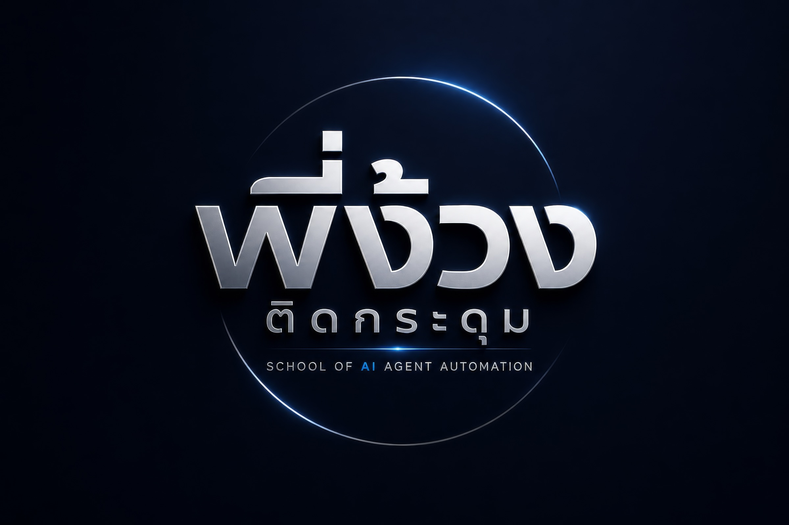

# ระบบ AI ของธุรกิจคุณ · ชุดครู AI

พี่ง้วง · School of AI Agent Automation · LINE OA @pngoung

เปิดโฟลเดอร์นี้ใน **Codex หรือ Claude Code ที่อ่าน/เขียนไฟล์และใช้ Terminal ได้** แล้วพิมพ์:

> อ่าน INSTRUCTOR.md และ PROGRESS.md แล้วพาฉันเริ่มสร้างระบบ AI ของธุรกิจตัวเอง ถามทีละคำถาม รับลิงก์และโฟลเดอร์ข้อมูลของฉัน วิเคราะห์สินค้าและแบรนด์ เตรียมน้องเก้าให้ใช้ระหว่างเรียน จากนั้นพาติดตั้งแชทบอท Console และ AI Gateway บน VPS เลือกโมเดล OpenAI/Claude แยกตามงานและทดสอบจนตรวจใช้งานได้ แล้วค่อยต่อ Content Studio

AI จะช่วยทำงานในเครื่องให้ และพาไปทีละขั้น คุณทำเฉพาะการตัดสินใจธุรกิจ เข้าบัญชี ใส่คีย์ และชำระเงินเอง
**INSTRUCTOR.md ไม่ได้ถูกรันอัตโนมัติแค่ดาวน์โหลด** ต้องเปิดโฟลเดอร์ในเครื่องมือ AI แล้วส่งข้อความเริ่มก่อน
ChatGPT ที่อ่านเอกสารได้อย่างเดียวช่วยจัดข้อมูลได้ แต่ยังติดตั้ง VPS เองไม่ได้

| ส่วน | สิ่งที่จะได้ |
|---|---|
| ข้อมูลธุรกิจ | สินค้า ราคา FAQ น้ำเสียง แบรนด์ และแหล่งอ้างอิงที่เจ้าของตรวจแล้ว |
| น้องเก้า | ชุดความรู้ให้แอดมินใช้ช่วยตอบระหว่างเรียน ต้องมีบัญชีและเชื่อมร้านของคุณ |
| แชทบอท + Console | แกนรุ่นใช้งานจริง + AI Gateway, เลือกโมเดลรายงาน, สลับคีย์สำรอง, ตัวติดตั้ง VPS/HTTPS และต่อ LINE OA |
| Content Studio | เว็บของร้านและ blueprint ของ Make สำหรับเตรียมรูป/แคปชันและโพสต์ |

เริ่มจาก `INSTRUCTOR.md` · ความคืบหน้า `PROGRESS.md` · เตรียมของ `references/prepare.md`

ชุดนี้รวมโปรแกรมไว้ใน `modules/` ไม่ต้องเข้าถึง GitHub ของครูก่อนเริ่ม
เผยแพร่เป็น public repo: https://github.com/pgnoung/business-ai-classroom
ฐานระบบมาจากรุ่นที่ตรวจเทียบกับ VPS ใช้งานจริงวันที่ 11 พ.ย. 2026 (commit `4316f979`) แล้วเพิ่มตัวเปลี่ยนธุรกิจและตัวติดตั้งสำหรับผู้เรียน
ไม่รวมความรู้ บัญชี แชต หรือฐานข้อมูลของระบบต้นทาง ดูขอบเขตและผลตรวจใน `RELEASE-NOTES.md`
ข้อมูลของผู้เรียนเก็บนอก repo และห้าม commit ข้อมูลธุรกิจจริงหรือคีย์ขึ้น GitHub

ดาวน์โหลดทั้งชุด: [ZIP](https://github.com/pgnoung/business-ai-classroom/archive/refs/heads/main.zip)
หรือใช้ `git clone https://github.com/pgnoung/business-ai-classroom.git` แล้วเปิดโฟลเดอร์ใน Codex/Claude Code

อัปเดต 12 พ.ย. 2026: รวม AI Gateway จากฐานใช้งานจริงแล้ว ดูสิ่งที่เหมือนและต่างใน [PARITY.md](PARITY.md) และวิธีเลือกโมเดลใน [คู่มือ Gateway](modules/chatbot/gateway/README.md)
