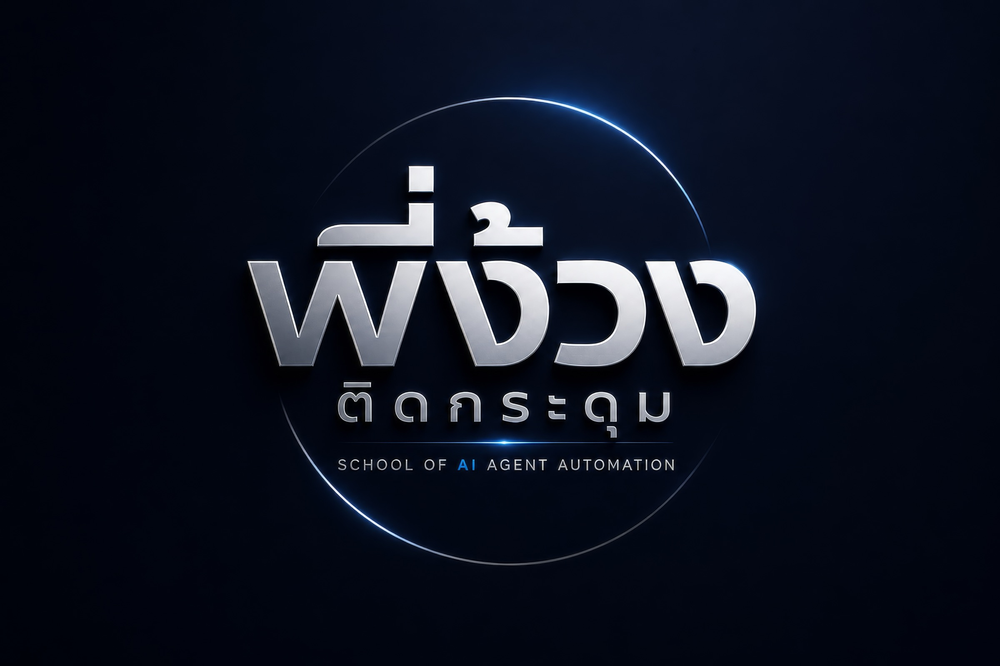

# AI Admin Starter — AI แอดมินหน้าร้านบน LINE OA (white label)

ให้ร้านของคุณมี "แอดมิน AI" ชื่อที่คุณตั้งเอง ตอบลูกค้าใน LINE ด้วยข้อมูลร้านจริง ส่งรูปสินค้าได้ บอกราคาเฉพาะที่คุณอนุมัติ
และส่งต่อให้คนทันทีเมื่อเป็นเรื่องเงิน ร้องเรียน หรือคำถามที่ไม่มีข้อมูล — คุมทุกห้องได้จากหน้า console บนมือถือ

ใช้แกนเดียวกับ AI แอดมินที่พี่ง้วงใช้ขายคลาสจริงทุกวัน

## ทำอะไรได้

- **ตอบเหมือนแอดมินคนจริง** รอลูกค้าพิมพ์จบก่อนตอบ ตอบเป็นบับเบิลสั้น ๆ น้ำเสียงตามที่ร้านกำหนด ส่งรูปสินค้าตามที่ลูกค้าถาม
- **ราคาปลอดภัย** บอกราคาได้เฉพาะรายการที่ร้านอนุมัติ ไม่มีราคา = ส่งให้ทีม
- **ส่งต่อให้คน** ธง "ต้องการคน" + ปิด AI รายห้อง + ทีมตอบจากหน้า console ได้เลย
- **ออเดอร์ · แท็กลูกค้า · บรอดแคสต์ · ข้อความตามขั้น** ในหน้า console เดียว
- **ซื่อตรง** ลูกค้าถามว่าเป็นบอทไหม ตอบความจริงเสมอ
- **ข้อมูลอยู่ที่คุณ** รันบน VPS ของร้านเอง ใช้คีย์ OpenAI/Claude ของร้านเอง ผ่าน AI Gateway บนเครื่องเดียวกัน

## เริ่มต้น (แนะนำ: ให้ AI ติดตั้งให้)

1. เปิดโฟลเดอร์นี้ใน **Claude Code** หรือ **Codex**
2. เปิดไฟล์ [`00_START_HERE_PROMPT.md`](00_START_HERE_PROMPT.md) คัดลอกกล่องข้อความไปวางในแชท
3. ทำตามที่ AI บอก — AI จะพาเช่า VPS, ติดตั้ง, ใส่ข้อมูลร้าน (โยนเมนู/รูป/ราคามาในแชทได้เลย), ลองแชท และต่อ LINE ให้

ต้องมี: คอม Mac หรือ Windows 10/11 · VPS Ubuntu 24.04 (RAM 2 GB ขึ้นไป) · บัญชี OpenAI ที่เติมเครดิตแล้ว · LINE OA ของร้าน

## คำสั่งด้วยมือ

macOS/Linux `bash ai-admin.sh <คำสั่ง>` · Windows `powershell -ExecutionPolicy Bypass -File ai-admin.ps1 <คำสั่ง>`

```
check · keygen · connect <IP> · key-upload · deploy · owner · secrets
model-test · import [business] [--apply] · chat "ข้อความ" · line · golive on|off
harness <cases.json> · chat-sink · chat-redact
status · logs · restart · backup · rollback · update
```

รายละเอียดแต่ละขั้นอยู่ใน `.claude/skills/ai-admin-setup/` (Codex: `.agents/skills/ai-admin-setup/`)

## โครงสร้าง

| ที่ | คืออะไร |
| --- | --- |
| `starter/` | ตัวช่วยบนเครื่องคุณ (SSH ไป VPS), สคริปต์ฝั่งเซิร์ฟเวอร์, ตัวจำลองแชทเป็นชุด และเครื่องมือสกัดแชท LINE OA |
| `.claude/skills/`, `.agents/skills/` | 4 skill ให้ AI: ติดตั้ง (`ai-admin-setup`) · เทรน (`ai-admin-training`) · จำลองแชทเป็นชุด (`chat-harness`) · สกัดแชทเก่า (`line-oa-chat-export`) |
| `harness-cases.example.json` | ตัวอย่างเคสจำลองแชท |
| `business-example/` | ตัวอย่างข้อมูลร้าน (ร้านกาแฟสมมติ) — ข้อมูลจริงของคุณอยู่ใน `business/` |
| `src/`, `public/`, `config/`, `tools/` | ตัวระบบ (Node 22 ไม่มี dependency) |
| `test/` | ชุดเทสต์ `node --test` |

## ความปลอดภัยและความเป็นส่วนตัว

ค่าลับพิมพ์เองใน Terminal เท่านั้น (ไม่ผ่านแชทกับ AI) · เก็บบน VPS ในไฟล์ที่อ่านได้เฉพาะระบบ · ไฟร์วอลล์เปิดแค่ 22/80/443 ·
หน้า console ต้องล็อกอิน (HTTPS) · ข้อความลูกค้าถูกส่งให้ผู้ให้บริการ AI ที่เลือก (OpenAI/Anthropic) เพื่อร่างคำตอบ — แจ้งลูกค้าตามนโยบายความเป็นส่วนตัวของร้าน ·
`business/`, `backups/`, `starter/.state.json` อยู่ในเครื่องคุณและไม่ถูก commit

อ่านวิธีเลือกโมเดล คีย์สำรอง การอัปเกรด และข้อจำกัดใน [gateway/README.md](gateway/README.md)

<!-- pngoung-brand:start -->
---

<p align="center">
  <a href="https://line.me/R/ti/p/@pngoung"></a>
</p>

<h3 align="center">อยากสร้างระบบ AI ที่ทำงานแทนได้จริงแบบนี้เป็น</h3>

<p align="center">
  <b>พี่ง้วง · School of AI Agent Automation</b><br>
  คลาสเรียน AI Agent · Automation · LINE OA และ <b>In-house Training</b> สำหรับทีมและองค์กร เน้นลงมือทำกับงานจริงของคุณ<br>
  สอบถามได้ที่ LINE OA <a href="https://line.me/R/ti/p/@pngoung"><b>@pngoung</b></a>
</p>

<p align="center"><sub>made with ♡ by pngoung</sub></p>
<!-- pngoung-brand:end -->
